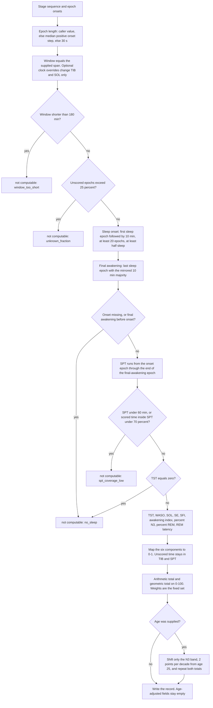

# Sleep Quality Index, sqi-1.0.0

This is an objective, single-night index computed from a hypnogram. It is not the Pittsburgh Sleep Quality Index, and it should not be called by that name. The Pittsburgh instrument is a subjective questionnaire (Buysse, Reynolds, Monk, Berman, and Kupfer, *Psychiatry Research*, 1989). This index never sees satisfaction, alertness, or daytime function. Those are not in a polysomnogram.

The sleep-stage classifier was left frozen. No model file, `cache/split_workaround.json`, `cache/index.parquet`, or `cache/raw/` was modified. Reference scores use the expert stage column already stored in the epoch table. Prediction scores use `cache/oof_lgbm.npy` only. There is no ensemble out-of-fold file for all 80 development subjects. CNN probabilities exist for the 16 validation subjects, and `cache/test_release_probs.npy` is the frozen test set, which was not re-scored.

The reported total is the weighted arithmetic mean on a 0–100 scale. The weighted geometric mean is stored beside it. Version string: `sqi-1.0.0`.

Implementation: `sqi.py`. Batch scores and checks: `sqi_validate.py`. Tables: `sqi_reference.csv` (197 recordings, expert stages) and `sqi_predicted.csv` (158 development recordings, out-of-fold stages). Machine-readable checks: `sqi_validation.json`.

## 1. Index definition

### Window and denominators

The analysis window is the recording that was supplied. At judging that is expected to be a sleep-period file of about 7–10 hours. The module does not read lights-off, age, or cohort unless the caller passes age for the secondary score.

Locally, the expert epoch table is already the study analysis window: about 30 minutes before the first non-wake epoch through about 30 minutes after the final one. Cassette files on disk are about 20 hours and include the daytime. Those full files are not the supplied window. Section 6 measures what happens if they are.

| Quantity | Definition |
|---|---|
| Sleep onset | First epoch scored N1, N2, N3, or REM that is followed by 10 minutes in which at least half the epochs are sleep. On a 30 s grid that follow-up must contain at least 20 epochs. Unscored epochs count as non-sleep in the percentage. |
| Final awakening | Last sleep epoch preceded by the same 10-minute majority. |
| SPT | Sleep onset through the end of the final-awakening epoch. |
| TST | Minutes of N1+N2+N3+REM inside SPT. |
| TIB | Span of the analysis window. **This is a proxy for time in bed.** Every output row sets `tib_is_window_proxy` true. |
| WASO | Wake minutes inside SPT. Unscored minutes are not wake. |
| SOL | Window start to sleep onset. **Meaningful only if the window starts near lights-off.** Every row sets `sol_assumes_lights_off` true. |
| SE | TST / TIB. |
| Awakening index | Wake bouts of at least one epoch inside SPT, per hour of SPT. Reported, not one of the six weighted components. |
| SFI | Stage transitions per hour of SPT. A transition is a clock-adjacent pair of scored stages that differ. An unscored epoch or a gap breaks the chain and is not a transition. |
| REM latency | Sleep onset to the first REM epoch inside SPT. Absent REM is missing, and that sub-score is 0. |

Unscored epochs (unknown, movement, any code outside 0–4) stay in the clock. They lengthen TIB and, when they fall inside SPT, they lengthen SPT. They are excluded from TST and from WASO, so TST + WASO is shorter than SPT by the unscored minutes. Dropping them from the denominator would raise SE. That is not done. A gap in the onset times is treated the same way: the span keeps the gap, and no stage is invented to fill it.

### Six components

Each map is piecewise linear and clipped to [0, 1]. Knots that the literature supports are cited. Knots with no source are marked as project assumptions. None of these knots were moved after the validation numbers were known.

**C1 Duration, from TST.** 0 at and below 5 h, rising to 1 at 7 h, held at 1 through 9 h, falling to 0.7 at 10 h, and held at 0.7 after that.

The starting sketch used 0 at 4 h. That was moved, before validation, to 5 h. Hirshkowitz and colleagues (*Sleep Health*, 2015) rate under 6 h as not recommended for adults 26–64, and 6 h as only “may be appropriate,” so 6 h scores 0.5. Under 5 h is not recommended for adults 65 and older as well. The 7–9 h plateau is the recommended band for adults 18–64 in that same report. Watson and colleagues (*Sleep*, 2015) recommend 7 or more hours for a healthy adult. Adults 65 and older are recommended 7–8 h, and 9 h is only “may be appropriate” for them (Hirshkowitz et al., 2015). Version 1 does not age-adjust duration, so 8–9 h receives full credit at every age. Holding the score at 0.7 from 10 h, rather than taking it to 0, is a project assumption. More than 10 h is not recommended for adults 26–64, but long sleep is a mixed group (Grandner and Drummond, *Sleep Medicine Reviews*, 2007), and a single long night is not treated as the absence of sleep.

**C2 Efficiency, from SE.** 0 at and below 65%, rising to 1 at 85%, and held at 1 above that.

The 85% full-credit line is the figure used as a normal sleep efficiency in the insomnia literature and in the chronic-insomnia guideline (Schutte-Rodin, Broch, Buysse, Dorsey, and Sateia, *Journal of Clinical Sleep Medicine*, 2008; Edinger and colleagues, *Sleep*, 2004, note that 85% has commonly been treated as normal). The 65% floor is a project assumption. At 75% the score is 0.5.

**C3 Latency, from SOL.** 1 at and below 15 min, falling to 0 at 60 min, and held at 0 after that.

Thirty minutes, the usual complaint threshold, scores two-thirds. Lichstein, Durrence, Taylor, Bush, and Riedel (*Behaviour Research and Therapy*, 2003) settled on a sleep-onset latency or wake-after-sleep-onset of at least 31 minutes as the quantitative severity criterion. Schutte-Rodin and colleagues (2008) list a sleep latency over 30 minutes among the common insomnia complaints. The 15-minute full-credit point and the 60-minute floor are project assumptions placed around that 30-minute line.

**C4 Continuity, from WASO.** 1 at and below 20 min, falling to 0 at 60 min.

The starting sketch reached 0 only at 90 min, which would have scored the 31-minute criterion at about 0.84. The floor was moved to 60 min before validation, so 31 minutes scores 0.725. The 20-minute and 60-minute anchors are project assumptions around the Lichstein 31-minute criterion and the Schutte-Rodin “WASO greater than 30 minutes” complaint.

**C5 Fragmentation, from SFI.** 1 at and below 10 transitions per hour of SPT, falling to 0 at 30.

Laffan, Caffo, Swihart, and Punjabi (*Sleep*, 2010) showed that a stage-transition rate predicts restless and light sleep after TST, stage percentages, WASO, and the arousal index are accounted for. In the Sleep Heart Health Study their 3-state rate (wake, NREM, REM), per hour of sleep, had median 10.11 and interquartile range 7.76–13.35, and the association rose through about 12 per hour. That is a different state space and a different denominator from this 5-stage rate per hour of SPT, so their quartiles are not used as cut-points. Both the 10 and the 30 are project assumptions. The construct, and the decision to keep a fragmentation term at all, is theirs. After scoring, the 197 nights had a median SFI of 14.0 per hour (10th percentile 8.1, 90th percentile 20.6). That distribution was not used to set the knots. It does show that the ramp is occupied rather than piled up at one end.

**C6 Architecture,** the mean of three sub-scores.

- Percent N3 of TST: full credit from 13% to 23%, which is stage 3 (about 3–8%) plus stage 4 (about 10–15%) in Carskadon and Dement’s overview (*Principles and Practice of Sleep Medicine*, 5th ed., 2011). The score is 0 at 0% N3. Above 23% it falls to 0.5 at 40% and holds at 0.5. The high-side floor of 0.5 is a project assumption. Extra slow-wave sleep is not scored as if it were missing sleep; rebound after sleep loss raises slow-wave time (Borbély, *Human Neurobiology*, 1982).
- Percent REM of TST: 0 at and below 5%, rising to 1 at 20%, held through 25%, then falling to 0.5 at 40% and held. The 20–25% plateau is Carskadon and Dement (2011). The 5% floor and the 40% taper are project assumptions.
- REM latency: 0 at 0 min, rising to 1 at 60 min, held through 120 min, falling to 0 at 240 min. A first REM episode about 80–100 minutes after sleep onset is the usual adult pattern (Carskadon and Dement, 2011). Latencies below about an hour are the short-latency region tied to depression (Kupfer, *Biological Psychiatry*, 1976). The 120-minute and 240-minute edges are project assumptions. If the sleep period contains no REM, this sub-score is 0 and the night is still scored.

### Weights

Fixed in `sqi.py` before `sqi_validate.py` was run, and not changed afterward:

| Component | Weight |
|---|---:|
| Efficiency (C2) | 0.25 |
| Continuity (C4) | 0.20 |
| Duration (C1) | 0.20 |
| Fragmentation (C5) | 0.15 |
| Latency (C3) | 0.10 |
| Architecture (C6) | 0.10 |

Åkerstedt, Hume, Minors, and Waterhouse (*Perceptual and Motor Skills*, 1994) found that the subjective meaning of good sleep was continuity, in particular calm sleep and sleep efficiency. Keklund and Åkerstedt (*Journal of Sleep Research*, 1997) found that slow-wave sleep and sleep efficiency were the strongest polysomnographic predictors of their diary sleep-quality index, with total sleep time and stage-0 wake contributing as well. That second paper is why architecture is kept, rather than dropped. Kaplan and colleagues (*Biological Psychology*, 2017), in 1,483 older adults, found that a large set of polysomnographic and clinical variables explained only 11–17% of subjective sleep quality, that sleep efficiency was the strongest objective correlate, that total sleep time and stage transitions also contributed, and that the amount of slow-wave sleep was not an important predictor. The insomnia thresholds that can actually be operationalized are sleep efficiency, wake after sleep onset, and sleep latency (Lichstein et al., 2003; Schutte-Rodin et al., 2008), not stage percentages.

Keklund and Åkerstedt do not support the claim that sleep efficiency is the single strongest predictor in every sample. In their sample, slow-wave sleep stood beside it. Kaplan’s larger and older sample does support efficiency over slow-wave amount. The architecture component here is also not pure slow-wave sleep: it averages N3 with REM percent and REM latency. The prespecified order was kept. Latency sits at 0.10, below wake after sleep onset, because the two are paired in the quantitative criteria and because latency is the term whose clock depends on an unverified lights-off assumption. A smaller weight limits how far a misaligned file start can move the total.

### Aggregation and the age-adjusted variant

The arithmetic total is 100 times the weighted sum of the six scores. The geometric total is 100 times the weighted product. A geometric total is 0 when any positively weighted component is 0.

Version 1 does not use age. If the caller passes age, a second architecture score is computed and both aggregators are repeated with that score in place of C6. Only the N3 band moves: about 2 percentage points of slow-wave sleep per decade, the adult rate in Ohayon, Carskadon, Guilleminault, and Vitiello (*Sleep*, 2004), applied to both edges of the 13–23% band and to the 40% taper, relative to age 25. The reference age is a project assumption. Ohayon’s Table 4 gives the exponential coefficient, not an intercept that could be copied, so the Carskadon band is anchored at 25 years and then shifted by their stated rate. REM percent and REM latency are not shifted. Ohayon and colleagues found a smaller REM change, on the order of 4 percentage points from young adults to age 60 and older, and a small REM-latency effect. The secondary fields are `sqi_arithmetic_age_adj` and `sqi_geometric_age_adj`. Section 4 shows what this does, and does not do, to the age gradient.

### Synthetic checks

`python3 -m unittest test_sqi.py`: 14 tests, all passed. The eight hypnograms:

| Night | What was asserted | Result |
|---|---|---|
| Perfect | 15 min wake, 7.5 h sleep, 18% N3, 22% REM, REM latency 60 min, three transitions. Every component is 1. Both totals are 100. | Pass |
| All wake | 8 h of wake. Reason `no_sleep`. No total. | Pass |
| Fragmented | 30 min wake, then 4 h of alternating N2 and wake. TST 120 min, WASO 119.5 min, SE 120/270, SFI = 478 × 120 / 479. Only latency scores (2/3). Arithmetic total 6.67. Geometric total 0. | Pass |
| Short | 30 min wake and 3 h of N2. Window 3.5 h, so it is scored. Duration 0, efficiency 1, latency 2/3, continuity 1, fragmentation 1, architecture 0. Arithmetic 66.67. Geometric 0. | Pass |
| No REM | N3 is inside 13–23%, REM sub-scores are 0, architecture is 1/3, and a total is still emitted. | Pass |
| No N3 | REM is 20% at a 60 min latency. Architecture is 2/3. | Pass |
| Single-epoch sleep | One N2 epoch inside wake. Reason `no_sleep`. | Pass |
| Missing labels | 30 unscored epochs inside SPT. TST 205 min, WASO 0, SPT 220 min, so the unscored quarter-hours stayed in the denominator. Coverage 410/440. | Pass |

Two further gates are asserted and passed: a 2 h block of pure sleep returns `window_too_short` before any total is built, and a window with 37.5% unscored epochs returns `unknown_fraction`. An age-25 versus age-80 pair confirms that version 1 is identical at both ages while the secondary N3 score moves. A prediction CSV with a blank probability row leaves that epoch unscored rather than calling `argmax` on missing values.

## 2. Flowchart

Unscored epochs and gaps are never deleted from a denominator. They are non-sleep for the onset rule, neither sleep nor wake for TST and WASO, and they break transitions and wake bouts.

## 3. Temazepam versus placebo

### What was expected before the numbers

The directions below were written into `sqi_validate.py` as `EXPECTED_TEMAZEPAM` before the paired test. The dose is not in `ST-subjects.xls`, so the expectation is the direction of a benzodiazepine hypnotic, not a predicted point change.

Temazepam shortens sleep latency and increases total sleep time in patients selected for sleep-onset insomnia (Roehrs, Lamphere, Paxton, Wittig, Zorick, and Roth, *British Journal of Clinical Pharmacology*, 1984). In that study it also lengthened REM latency, increased stage 2, and reduced REM percent only with chronic dosing. At 30 mg over weeks, temazepam suppressed slow-wave sleep and did not suppress REM time (Mitler, Carskadon, Phillips, and colleagues, *British Journal of Clinical Pharmacology*, 1979). Wake during the night and the number of awakenings should fall. Sleep efficiency should rise.

Mapped onto this index, before looking at Sleep-EDF: duration, efficiency, and continuity should rise; latency should improve if SOL falls; architecture should fall if N3 falls; REM percent should change little; REM latency should lengthen; the fragmentation rate had no committed direction. Because efficiency, continuity, and duration together carry 0.65 of the weight, and architecture carries 0.10, the arithmetic total was expected to rise. The primary contrast was specified as that total. Component tests are explanations of the total, not a second family of primary claims.

### What happened

All 22 telemetry subjects had two scored nights. Paired difference is temazepam minus placebo. The interval is a 10,000-draw percentile bootstrap of the mean. The test is a two-sided Wilcoxon signed-rank test.

| Measure | Expected | Mean difference | 95% CI | Wilcoxon p | Reading |
|---|---|---:|---|---:|---|
| Arithmetic SQI | rise | +10.05 | 4.38 to 16.52 | 0.005 | Matched. Higher on 15 of 22 nights. |
| Geometric SQI | none | +16.96 | 6.76 to 29.07 | 0.005 | Not a prespecified direction. |
| C1 duration | rise | +0.076 | 0.029 to 0.132 | 0.012 | Score rose. |
| TST, minutes | rise | +14.1 | −1.4 to 30.3 | 0.17 | Raw TST did not clearly rise. |
| C2 efficiency | rise | +0.107 | 0.038 to 0.203 | 0.006 | Matched. |
| SE, fraction | rise | +0.034 | 0.007 to 0.064 | 0.033 | Matched. About 3.4 percentage points. |
| C3 latency | rise | −0.010 | −0.099 to 0.073 | 0.94 | No movement. |
| SOL, minutes | fall | −0.05 | −5.0 to 5.4 | 0.65 | No movement. |
| C4 continuity | rise | +0.253 | 0.102 to 0.407 | 0.011 | Matched. |
| WASO, minutes | fall | −15.6 | −29.0 to −4.5 | 0.010 | Matched. |
| Awakening index, per hour | fall | −0.50 | −1.00 to −0.05 | 0.079 | Bootstrap interval excludes 0. Rank test is borderline. |
| C5 fragmentation | none | +0.047 | −0.033 to 0.130 | 0.29 | SFI fell 1.4 per hour, interval includes 0. |
| C6 architecture | fall | +0.020 | −0.028 to 0.069 | 0.34 | Did not fall. |
| N3, percent of TST | fall | −0.31 | −2.60 to 2.39 | 0.46 | Did not fall. |
| REM, percent of TST | little change | −0.05 | −2.40 to 2.37 | 1.00 | Consistent with little change. |
| REM latency, minutes | rise | +8.5 | −10.4 to 27.2 | 0.36 | Direction only. Interval includes 0. |
| N1, percent of TST | none | −3.07 | −5.09 to −1.05 | 0.017 | Not prespecified. N1 is not a component. |

Placebo nights averaged 80.0 and temazepam nights 90.1 on the arithmetic index. WASO went from 33.8 to 18.3 minutes. SE went from 0.848 to 0.881. N3 went from 17.1% to 16.8%. REM stayed at about 21.6%.

The total moved the way a continuity-weighted index should move when wake after sleep onset falls. The architecture prediction was not confirmed in these 22 pairs. Mitler and colleagues saw slow-wave suppression at 30 mg over weeks. This file does not record the dose or the chronicity, and a one-night within-subject contrast at an unknown dose need not reproduce that suppression. Reporting a flat N3 difference is the result.

The latency prediction was also not confirmed, and the hypnograms are why. Placebo SOL on these telemetry nights already averaged 17.3 minutes, inside the region where C3 is nearly 1, so the mapped score had little room to rise. A sensitivity that restarts the clock at the spreadsheet lights-off time, which for this cohort sits about a minute from the window start, gives a temazepam-minus-placebo SOL difference of +0.9 minutes (median 0, Wilcoxon p = 0.87). The drug effect that is in this scoring is continuity, not sleep onset. Roehrs and colleagues (1984) studied patients whose sleep latency exceeded 30 minutes. These scored placebo nights were already shorter than that.

N1 percent fell by about 3 points. That fits the stage-1 reduction in the 1984 temazepam staging table. It was not a prespecified component, and it is not given a weight.

The mapped duration score rose while raw TST did not clearly rise. A few nights crossed a knot in the 5–7 h ramp. The raw minutes are the physiological statement. The score is the index’s compression of them.

## 4. Age gradient

Expected from Ohayon and colleagues (*Sleep*, 2004), written down before the correlations: in adults, TST, sleep efficiency, percent slow-wave sleep, and REM latency decline with age, while sleep latency, percent stage 1, and WASO rise. The version-1 index, which does not age-adjust, was therefore expected to decline with age. The check uses the 78 cassette subjects, ages taken from `SC-subjects.xls`. Each subject contributes the mean of the nights that scored. Three subjects have one night. The other 75 have two. Night-level correlations are secondary, because two nights from one person are not independent.

Subject-level Spearman correlations with age, n = 78:

| Measure | Expected | ρ | p |
|---|---|---:|---:|
| Arithmetic SQI, version 1 | decline | −0.691 | 2.4×10⁻¹² |
| Age-adjusted arithmetic SQI | see below | −0.671 | 1.7×10⁻¹¹ |
| SE | decline | −0.618 | 1.7×10⁻⁹ |
| C2 efficiency | decline | −0.617 | 1.9×10⁻⁹ |
| WASO | rise | +0.545 | 2.5×10⁻⁷ |
| C4 continuity | decline | −0.610 | 3.0×10⁻⁹ |
| N3, percent of TST | decline | −0.411 | 1.9×10⁻⁴ |
| C6 architecture | decline | −0.502 | 2.8×10⁻⁶ |
| Age-adjusted architecture | flatter than C6 | −0.328 | 0.003 |
| N1, percent of TST | rise | +0.680 | 7.5×10⁻¹² |
| SOL | rise | +0.297 | 0.008 |
| C3 latency | decline | −0.306 | 0.006 |
| TST | decline | −0.044 | 0.70 |
| C1 duration | decline | −0.158 | 0.17 |
| C5 fragmentation | none | −0.063 | 0.58 |

Sleep efficiency, WASO, N3, N1, and SOL agree with Ohayon and colleagues. TST does not. A loss of about 10 minutes per decade would be visible in principle from the mid-20s to 100, and it is not present in these 78 subject means (ρ = −0.04). The duration component therefore does not carry the age gradient. Possible reasons, none of which are tested here, include the healthy-volunteer composition of the cassette cohort, two home nights rather than a laboratory protocol with a fixed time in bed, and the fact that the analysis window is already centered on sleep. The disagreement is reported as a property of this sample.

The index itself declines strongly (ρ = −0.69). The carriers are efficiency, continuity, N1, and N3.

### The age-adjustment tension

Adjusting the N3 band was expected to neutralize this gradient, because percent N3 is the architecture term that falls with age. It does not. The age-adjusted total still correlates with age at ρ = −0.67. Efficiency and continuity are 0.45 of the weight, they are not age-adjusted, and both track age more tightly than N3 does. Shifting only N3 cannot flatten a gradient that lives mainly in wake.

Inside the architecture component the adjustment does part of the job: the correlation moves from −0.50 to −0.33. It does not go to zero, because REM percent and REM latency stay on the young-adult scale, and because a 2-point-per-decade shift does not absorb all of the N3 difference in this sample.

That is the design choice, and both outputs are shipped.

Version 1 asks how the night compares with a young-adult physiological standard. It is allowed to be lower at 80 than at 30, and section 4 shows that it is. That is the right primary score when the question is whether sleep, as recorded, changes across the adult lifespan.

The age-adjusted score asks how the night compares with what is usual at that age. It is the right secondary score when the question is whether a night is poor for that person. Using it as the only total would hide the continuity changes that Ohayon and colleagues also documented, and it would make the age check in this section almost circular. It is stored on every row that has an age. It is not the headline number.

## 5. Weight sensitivity

Each of the six weights was multiplied by an independent Uniform(0.7, 1.3) draw and the six products were renormalized. One thousand draws, seed 42, on the 197 scored reference nights. The comparison is the Spearman correlation between the perturbed ranking and the ranking under the prespecified weights.

| Summary of the 1000 correlations | Value |
|---|---:|
| 5th percentile | 0.994 |
| Median | 0.998 |
| Mean | 0.997 |
| Minimum | 0.986 |

A recording’s own score does move. The median within-recording standard deviation across the 1000 draws is 1.8 points on the 0–100 scale. The median within-recording range is 9.8 points, and the 95th percentile of that range is 19.8 points. Ranks are stable. Individual scores are not invariant. The 5th percentile of 0.994 is high enough that the ordering of nights is not an artifact of the exact weights. The weights were not revised in response.

## 6. Time-in-bed proxy

TIB in the index is the span of the supplied window. The spreadsheets carry a lights-off clock. For each recording, that clock was placed on the date that puts it nearest the analysis-window start, because the sheet has a clock and no date. Sleep efficiency and the full arithmetic index were then recomputed with the window starting at lights-off and ending at the same window end. All 197 reference nights still scored under that clock.

Bias is the window proxy minus the lights-off value. A negative SE bias means the proxy denominator is longer, and the proxy efficiency is lower.

| | SE, percentage points | Arithmetic SQI, points | SOL, minutes |
|---|---:|---:|---:|
| Mean absolute error | 6.25 | 8.13 | 34.8 |
| Median absolute error | 3.27 | 4.07 |  |
| Mean bias, proxy minus lights-off | −5.62 | −6.87 | +28.8 |
| Median bias | −2.81 | −3.33 |  |

Spearman correlation between the two sleep efficiencies: 0.787. Between the two totals: 0.856.

The proxy window on these files starts earlier than lights-off often enough that SOL is longer and SE is a few points lower. One hundred twenty-six of the 197 nights have SOL exactly 30.0 minutes, which is the trim that built the local epoch table (30 minutes before the first non-wake epoch), not a biological constant. On a judging file that already starts near lights-off, that 30-minute pile-up will not be there. The lights-off comparison is the estimate of the damage: a few points of SE and about 3 to 8 points on the total, with ranks largely preserved (ρ = 0.86).

A second comparison asks what happens if the supplied file is the entire PSG rather than the sleep period. TIB becomes the header duration, often about 22 hours for a cassette. Every one of the 197 nights scored. The proxy SE is higher than this full-file SE by 30.7 percentage points on average and 36.3 at the median, in the same direction for the median absolute error and the median bias, so the error does not change sign. The arithmetic total is higher by 13.9 points on average and 11.0 at the median. Spearman correlation of the two efficiencies falls to 0.475. The totals still correlate at 0.895, because TST, WASO, SFI, and architecture do not use TIB. Latency and efficiency do, and they are 0.35 of the weight, which is where the 11–14 point shift comes from.

The module therefore assumes the file it is given is the sleep period. That is the judging condition. Passing a raw 20-hour cassette through `sqi.py` will score the night, and the efficiency term will be wrong by about 30 percentage points.

## 7. Error propagation

Development recordings only, 158 nights, all of them scored from both the expert stages and the LightGBM out-of-fold probabilities. Bias is prediction minus reference. The single-ratio index on the same nights is 100 × TST / SPT.

| Measure | MAE | Bias | Spearman |
|---|---:|---:|---:|
| Arithmetic SQI | 7.54 | −0.92 | 0.883 |
| Geometric SQI | 6.76 | −1.25 | 0.934 |
| C1 duration | 0.081 | −0.012 | 0.767 |
| C2 efficiency | 0.084 | −0.007 | 0.921 |
| C3 latency | 0.093 | +0.023 | 0.686 |
| C4 continuity | 0.118 | +0.009 | 0.816 |
| C5 fragmentation | 0.180 | −0.058 | 0.504 |
| C6 architecture | 0.129 | −0.007 | 0.679 |
| TST, minutes | 20.0 | +3.0 | 0.845 |
| SPT, minutes | 20.2 | +1.4 | 0.906 |
| WASO, minutes | 26.4 | −1.6 | 0.852 |
| SOL, minutes | 11.8 | −2.0 | 0.689 |
| SFI, per hour | 4.02 | +1.50 | 0.507 |
| N3, percent of TST | 5.00 | +0.72 | 0.756 |
| REM, percent of TST | 4.71 | −0.88 | 0.623 |
| 100 × TST / SPT | 3.96 | +0.23 | 0.837 |

The earlier one-ratio index had a reference-versus-prediction Spearman correlation of 0.569. Recomputed here, on these 158 nights, with this onset rule and these out-of-fold stages, 100 × TST / SPT correlates at 0.837. That 0.569 was not recovered. The clean comparison is therefore the one inside this table: the multi-component total at 0.883 against the ratio at 0.837 on the same recordings. The gain is real and it is modest, about 0.05 of correlation. It is not a 0.31 jump from 0.569, and it should not be described as one. Part of any difference from 0.569 is the ratio itself under this definition and this model, whose wake-versus-sleep decisions are already stable (SPT ρ = 0.91, SE ρ = 0.92).

The averaging argument holds where the staging errors are large. Fragmentation and SFI correlate only at about 0.50, because a false N1 boundary creates an extra transition. REM percent is 0.62 and architecture is 0.68. Those weaker terms are 0.15 and 0.10 of the weight, so they do not set the total. The total’s error (MAE 7.5 points, bias under 1 point) is smaller than the temazepam contrast (10 points) and much smaller than the spread of the age gradient.

The geometric correlation (0.934) is higher than the arithmetic correlation (0.883). Section 10 explains why that is not a reason to prefer it. Many nights are exactly 0 on both the expert geometric score and the predicted one, and shared zeros tighten a rank correlation.

## 8. Coverage

| Set | Nights | Scored | `window_too_short` | `unknown_fraction` | `no_sleep` | `spt_coverage_low` |
|---|---:|---:|---:|---:|---:|---:|
| Reference, all recordings | 197 | 197 | 0 | 0 | 0 | 0 |
| Prediction, development only | 158 | 158 | 0 | 0 | 0 | 0 |

The gates did not fire on this corpus. The trimmed windows run from 5.6 to 23.4 hours, every night has a sustained sleep period under the 10-minute rule, and the unscored fraction stays under 25% even after out-of-fold gaps are treated as unscored. The synthetic tests are what exercise the four refusal reasons. A refused night has null totals and null component scores. The reason string is the only index output.

Across the 197 reference nights the arithmetic mean is 65.8 and the median is 66.2. Cassette nights average 60.3 (median 53.7). Telemetry nights average 85.0 (median 92.4). The telemetry mean mixes placebo and temazepam and a hospital window that starts near lights-off. It is not a drug effect. The drug effect is the paired contrast in section 3.

## 9. Limitations

The index is one night. It has no estimate of how that night sits against the person’s own usual sleep.

The stage labels are Rechtschaffen and Kales labels remapped to five classes, with stages 3 and 4 combined into N3. They are not AASM-manual N3 scored on the recommended montage.

The EEG is Fpz-Cz and Pz-Oz, not the standard clinical derivation. The index uses the resulting stages, so any montage bias in N3 or REM is inherited by C6.

The cassette nights are home recordings and the telemetry nights are hospital recordings under a drug protocol. Acquisition, setting, and the reason for the recording all differ. Age correlations are restricted to the cassette cohort for that reason. The drug contrast is restricted to within-subject telemetry pairs.

There is no clinical validation against insomnia diagnosis, daytime sleepiness, or a later health outcome. There is no ground-truth sleep-quality label, so sections 3 through 7 are behavior checks, not accuracy.

Satisfaction and alertness are not recoverable from a polysomnogram. Kaplan and colleagues (2017) could explain only 11–17% of a next-morning quality rating from polysomnography plus clinical covariates. This index does not try to impute the rest. It is a summary of architecture and continuity. It is not a patient-reported outcome, and it is not the Pittsburgh Sleep Quality Index.

TIB is the file span. Section 6 is the size of that assumption. SOL is the same assumption at the other end of the night. One hundred twenty-six local nights have SOL exactly 30 minutes because of how the epoch table was trimmed. A file that starts at lights-off will not.

The 65% efficiency floor, the 15- and 60-minute latency knots, the 20- and 60-minute WASO knots, both fragmentation knots, the N3 and REM tapers, the 240-minute REM-latency floor, the age-25 anchor, and the four refusal thresholds are project assumptions. They are marked as such in section 1.

## 10. Which aggregator to report

Report the arithmetic mean.

A geometric mean is 0 as soon as any one component is 0. On these 197 nights that happens 89 times. Seventy-four of those nights have continuity at 0 (WASO at or above 60 minutes), 51 have efficiency at 0, and 20 have latency at 0. Architecture is never 0. The geometric mean is then 44.3 against an arithmetic mean of 65.8, and the median gap between them is 6.0 points. An index that reads zero on 89 ordinary nights in this cohort, including many older cassette nights whose only large fault is WASO, is not a usable summary. The zero is the WASO floor doing all of the work and erasing TST, REM, and efficiency when those are fine.

The refusal branch already returns “not computable” when there is no sleep, when the window is too short, or when the sleep period is too poorly covered to trust a denominator. The case a geometric mean is designed to catch, a night that should not receive a flattering total, is already outside the numeric scale. Inside the scored range, the components are different questions. Buysse (*Sleep*, 2014) treats sleep health as several dimensions, and a short night with low wake is a different night from a long night broken by wake. Letting the intact dimensions offset the weak one is the arithmetic mean’s job. Forcing one floor to zero the product throws away the dimensions the weights were written to balance.

Latency makes the same point mechanically. SOL is only as good as the assumption that the file starts at lights-off. A geometric mean would let a bad file start zero an otherwise coherent night. The arithmetic mean charges that mistake at its 0.10 weight.

The higher geometric Spearman in section 7 (0.934 against 0.883) comes from those shared zeros. Nights that are 0 on both the expert geometric score and the predicted one lock a rank. That is agreement about a floor, not a finer measurement. The recommendation was the arithmetic mean before those correlations were computed, on the design grounds above. The 89 zeros are the empirical consequence, and they argue in the same direction.

Both numbers are in the output. The headline is `sqi_arithmetic`.

## 11. Padding sensitivity

Section 6 scored the extreme case: the full cassette or telemetry file, with every pre-sleep minute still in the denominator. That moved sleep efficiency by 30.7 percentage points. The realistic judging risk is smaller. A submitted file can start earlier than the 30-minute trim used here and still be a sleep recording.

For all 197 reference nights the window start was moved earlier by 30, 60, 90, and 120 minutes. Those minutes were synthetic Wake epochs on the same 30-second grid, placed before the current first onset. The end of the window was left where it is. Every night still scored. Change is the padded value minus the unpadded value. Sleep efficiency is in percentage points. C2 and C3 are on the 0–1 component scale. The total is the arithmetic SQI.

| Leading wake | SE, mean / median | SOL, min | C2, mean / median | C3, mean / median | Arithmetic SQI, mean / median | Spearman vs unpadded |
|---|---|---|---|---|---|---|
| 30 min | −3.8 / −4.2 pp | +30 | −0.129 / −0.173 | −0.570 / −0.667 | −8.9 / −10.7 | 0.987 |
| 60 min | −7.2 / −8.0 pp | +60 | −0.261 / −0.338 | −0.636 / −0.667 | −12.9 / −15.3 | 0.962 |
| 90 min | −10.3 / −11.5 pp | +90 | −0.375 / −0.499 | −0.636 / −0.667 | −15.7 / −19.5 | 0.938 |
| 120 min | −13.2 / −14.7 pp | +120 | −0.465 / −0.580 | −0.636 / −0.667 | −18.0 / −22.6 | 0.918 |

SOL moves by exactly the pad on every night, because the sleep-onset epoch does not move. TST, WASO, SPT, and the architecture features do not move either, so C1, C4, C5, and C6 are unchanged. Efficiency falls because the same TST is divided by a longer TIB. Latency falls until SOL reaches the 60-minute knot, where C3 is already 0. No local night has SOL below 0, so 60 minutes of extra leading wake puts every night on that floor. The C3 column is therefore identical from 60 minutes onward. Further padding moves only SE and C2.

An organizer crop that includes one extra hour of pre-sleep wake would lower the typical arithmetic total by about 15 points (median −15.3, mean −12.9) and would leave the ranking largely intact (Spearman 0.962). Two extra hours lowers the mean total by 18 points, with Spearman 0.918. That is the sensitivity. Weights, knots, and `sqi-1.0.0` were left as they are.

## 12. Refusal branches on real recordings

On the 197 intact nights every gate returned a score, so the four reasons had only been shown on synthetic hypnograms. The three constructions below use epochs already in the epoch table. No new recording was read. Each case uses five recordings. The scored output was then inspected field by field.

| Construction | Recording | Reason | Window | Unknown fraction | Scores null |
|---|---|---|---:|---:|---|
| First 2 hours kept | SC4001E0 | `window_too_short` | 120 min | 0 | yes |
| First 2 hours kept | SC4002E0 | `window_too_short` | 120 min | 0.004 | yes |
| First 2 hours kept | SC4011E0 | `window_too_short` | 120 min | 0 | yes |
| First 2 hours kept | SC4012E0 | `window_too_short` | 120 min | 0 | yes |
| First 2 hours kept | SC4021E0 | `window_too_short` | 120 min | 0 | yes |
| 30% of labels set to unscored | SC4022E0 | `unknown_fraction` | 505 min | 0.301 | yes |
| 30% of labels set to unscored | SC4031E0 | `unknown_fraction` | 476 min | 0.300 | yes |
| 30% of labels set to unscored | SC4032E0 | `unknown_fraction` | 455.5 min | 0.300 | yes |
| 30% of labels set to unscored | SC4041E0 | `unknown_fraction` | 618 min | 0.301 | yes |
| 30% of labels set to unscored | SC4042E0 | `unknown_fraction` | 602 min | 0.302 | yes |
| Wake epochs only, original onsets | SC4001E0 | `no_sleep` | 420.5 min | 0 | yes |
| Wake epochs only, original onsets | SC4002E0 | `no_sleep` | 564 min | 0 | yes |
| Wake epochs only, original onsets | SC4011E0 | `no_sleep` | 551.5 min | 0 | yes |
| Wake epochs only, original onsets | SC4012E0 | `no_sleep` | 593 min | 0 | yes |
| Wake epochs only, original onsets | SC4021E0 | `no_sleep` | 512.5 min | 0 | yes |

The 2-hour files are the opening 120 minutes of the real onset grid (240 epochs). The unknown-fraction files blank the nearest 30% of epoch labels to unscored, so the realized fraction is 0.300 to 0.302, above the 0.25 gate. The wake-only files drop every sleep epoch and keep the remaining Wake epochs on their original onset times. The clock from the first wake epoch to the last is still longer than 3 hours, so the short-window gate does not fire first, and the reason is `no_sleep`.

On all 15 rows the arithmetic total, the geometric total, both age-adjusted totals, and all six component scores are null. The same is true of the raw sleep features (TST, SE, SOL, WASO, SPT, stage percentages). The populated index result is `unavailable_reason`. The row also keeps the measurements the gate itself computed: window length, epoch count, unknown fraction, and TIB. SPT and coverage stay null, because those gates never ran.

## 13. Presentation figures

All four files are 150 dpi.

`figures/sqi_s13a_temazepam.png`. Paired arithmetic SQI for the 22 telemetry subjects, placebo to temazepam, with the mean difference of +10.1 and its 95% interval 4.4 to 16.5.

`figures/sqi_s13b_age.png`. Subject-mean arithmetic SQI against age for the 78 cassette subjects, with an ordinary least-squares line and Spearman ρ = −0.691.

`figures/sqi_s13c_components.png`. SC4252E0, whose arithmetic total of 66.2 is the cohort median, drawn as the six weighted contributions that add to that total.

`figures/sqi_s13d_bland_altman.png`. Bland–Altman of prediction minus reference arithmetic SQI on the 158 development nights, with mean bias −0.92 and limits of agreement −22.7 to +20.9.

## 14. Cycle structure, sqi-1.1.0

`sqi-1.0.0` is unchanged. The default scorer, the weights, the component knots, `sqi_reference.csv`, and `sqi_predicted.csv` are the version scored in sections 1–13. `sqi-1.1.0` is a second scorer. It keeps the same six weights. C6, the architecture component, becomes the mean of four sub-scores: N3 percent, REM percent, REM latency, and a cycle-structure sub-score. The cycle term is the same number in the age-adjusted architecture mean. It is not shifted with age.

The cycle sub-score is the mean of the terms that are defined:

- Cycle count. A completed cycle is an NREM period of at least 15 minutes followed by a REM period of at least 5 minutes. NREM is N1, N2, or N3. Those two minima are Feinberg and Floyd (*Psychophysiology*, 1979). They waived the 5-minute minimum for the first REM period; this index applies it to every REM period, which is a project choice. A REM stretch shorter than 5 minutes does not end the NREM period. NREM shorter than 15 minutes between REM stretches does not end the REM period, and those minutes stay in the NREM total. That is their intercurrent-NREM rule. Wake or unscored time shorter than 15 minutes is skipped and left out of the duration. A break of 15 minutes or more ends the period. Using 15 minutes for wake, and leaving wake out of the duration, are project assumptions. Cycle duration is NREM minutes plus REM minutes. Full credit is 4–6 cycles, the usual adult range (Carskadon and Dement, 2011). The score is 0 at 0 cycles and at 1 cycle, rises linearly to 1 at 4, stays at 1 through 7, and falls to 0 at 10. The rise, the hold through 7, and the zero at 10 are project assumptions. "Tapering above 7" is read as a decline that starts after 7, so 7 itself is still full credit.
- Cycle regularity. `1` minus the sample coefficient of variation of those durations, clipped to `[0, 1]`. With fewer than two cycles the coefficient is undefined and the term is omitted from the mean. It is not scored 0. The formula is a project assumption.
- N3 front-loading. N3 epochs whose onset falls before the midpoint of the sleep period, divided by all N3 epochs. Full credit at or above 0.60, zero at or below 0.35, linear between. Both knots, and the use of the first half of the sleep period rather than the first NREM period, are project assumptions. The direction they reward is cited: Feinberg and Floyd (1979) report that the first NREM period normally holds about half of slow-wave sleep. A night with no N3 omits the term.

On the 197 reference nights the count has median 4 and mean 3.53, and every night has between 1 and 6 cycles (4 nights have one, 30 have two, 58 have three, 72 have four, 29 have five, 4 have six). Nineteen nights have no N3, so front-loading is omitted there. The four one-cycle nights omit regularity. The mean cycle sub-score is 0.78.

### What was expected, before the contrasts

Written into `sqi_cycles.py` before any paired difference or age correlation was computed.

Temazepam minus placebo. Roehrs and colleagues (*British Journal of Clinical Pharmacology*, 1984) reported longer total sleep and a longer REM latency. Those pull cycle count in opposite directions, so the count, its score, and the cycle sub-score were left uncertain. Regularity and its coefficient of variation have no temazepam citation, so they were left uncertain. Mitler and colleagues (*British Journal of Clinical Pharmacology*, 1979) reported slow-wave suppression, and Feinberg and Floyd place that slow-wave sleep in the first NREM period, so the first-half N3 fraction and its score were expected to fall. C6 was expected to fall for the same slow-wave reason as in section 3. The arithmetic total was expected to rise, because efficiency, continuity, and duration still carry 0.65 of the weight.

Age, 78 cassette subjects, subject means. Ohayon and colleagues (*Sleep*, 2004) reported shorter TST and less slow-wave sleep with age, so cycle count and its score were expected to fall, and the first-half N3 fraction and its score were expected to fall. Feinberg and Floyd's more constant cycle was reported in patients with chronic brain syndrome, which is not a healthy-aging result, so regularity was left uncertain. The cycle sub-score was left uncertain because its terms were not given one direction. The arithmetic total was expected to fall, as in section 4.

### Reliability rule

The rule, fixed before the correlations: if the Spearman correlation of the cycle sub-score between reference stages and out-of-fold predictions is below 0.50 on the 158 development nights, the sub-score stays a descriptive column and stays out of C6.

It cleared the floor. The sub-score correlates at 0.640 (n = 158, p = 1.3×10⁻¹⁹). It is inside C6. `CYCLE_IN_ARCHITECTURE` is true for `sqi-1.1.0` only.

The three pieces are not equally reproducible. Cycle count correlates at 0.739 and the N3 front-loading fraction at 0.729 (n = 138). Regularity correlates at 0.330 (n = 139). The rule was written on the sub-score, and the sub-score cleared 0.50, so regularity stays inside the mean. It is the weak term.

| Measure | n | Spearman, reference vs prediction |
|---|---:|---:|
| Cycle count | 158 | 0.739 |
| Cycle-count score | 158 | 0.671 |
| Duration CV | 139 | 0.330 |
| Regularity score | 139 | 0.330 |
| N3 front-loading fraction | 138 | 0.729 |
| Front-loading score | 138 | 0.772 |
| Cycle sub-score | 158 | 0.640 |

The 0.50 rule was applied to that combined sub-score, and the decision stands. `sqi-1.1.0` still includes regularity. The same 158 development nights, with the sub-score rebuilt from the terms that are defined:

- With regularity: Spearman 0.640.
- Count and front-loading only: Spearman 0.678.

Leaving regularity out raises the correlation by 0.037. That is a modest gain, and it is large enough to act on later: the term that reproduces at 0.330 is the one pulling the mean down, and the two-term mean is the more reliable sub-score. A future version should omit regularity. This version keeps it.

### Temazepam and age, beside version 1

| Contrast | sqi-1.0.0 | sqi-1.1.0 |
|---|---:|---:|
| Temazepam minus placebo, mean | +10.05 | +9.98 |
| 95% CI | 4.38 to 16.52 | 4.35 to 16.43 |
| Age Spearman, 78 cassette subjects | −0.691 | −0.685 |

The 1.1.0 total still rises on temazepam (15 of 22 subjects, Wilcoxon p = 0.0066) and still falls with age (p = 4.7×10⁻¹²). Folding the cycle term into a component that carries weight 0.10 moves the mean reference total by +0.12 points. The largest absolute change on one night is 1.7 points. C6's mean goes from 0.733 to 0.745.

Paired temazepam minus placebo on the cycle terms:

| Measure | Expected | n | Mean difference | 95% CI | Wilcoxon p | Reading |
|---|---|---:|---:|---|---:|---|
| Cycle count | uncertain | 22 | −0.05 | −0.50 to 0.41 | 0.86 | No committed direction. |
| Duration CV | uncertain | 22 | +0.029 | −0.077 to 0.127 | 0.42 | No committed direction. |
| N3 front-loading fraction | fall | 21 | +0.042 | −0.027 to 0.120 | 0.38 | Interval includes 0. |
| Cycle-count score | uncertain | 22 | +0.015 | −0.106 to 0.152 | 0.57 | No committed direction. |
| Regularity score | uncertain | 22 | −0.029 | −0.127 to 0.077 | 0.42 | No committed direction. |
| Front-loading score | fall | 21 | −0.005 | −0.141 to 0.135 | 1.00 | Interval includes 0. |
| Cycle sub-score | uncertain | 22 | −0.008 | −0.063 to 0.057 | 0.46 | No committed direction. |
| C6, four-term | fall | 22 | +0.013 | −0.031 to 0.061 | 0.61 | Interval includes 0. |
| Arithmetic total | rise | 22 | +9.98 | 4.35 to 16.43 | 0.0066 | Matched. |

One pair is missing from the N3 rows because one night had no N3, and that term is omitted rather than scored 0. The slow-wave prediction for front-loading was not confirmed. The total's rise is the same continuity result as in section 3, smaller by 0.07 points.

Subject-level Spearman with age, cassette cohort:

| Measure | Expected | n | ρ | p |
|---|---|---:|---:|---:|
| Cycle count | decline | 78 | −0.220 | 0.053 |
| Duration CV | uncertain | 77 | +0.040 | 0.73 |
| N3 front-loading fraction | decline | 72 | +0.015 | 0.90 |
| Cycle-count score | decline | 78 | −0.226 | 0.046 |
| Regularity score | uncertain | 77 | −0.040 | 0.73 |
| Front-loading score | decline | 72 | −0.048 | 0.69 |
| Cycle sub-score | uncertain | 78 | −0.219 | 0.054 |
| Arithmetic total | decline | 78 | −0.685 | 4.7×10⁻¹² |

The count leans down with age and the mapped count score reaches p = 0.046. Front-loading does not decline in this sample. The total's age correlation moves from −0.691 to −0.685. The gradient is still the efficiency and continuity gradient from section 4.

Outputs written beside the frozen tables: `sqi_reference_1.1.0.csv` (197 reference nights), `sqi_predicted_1.1.0.csv` (158 development nights; the test set was not scored), and `sqi_cycle_validation.json`. Calling the scorer without a version still returns `sqi-1.0.0`.

### Which version to report

`sqi-1.0.0` is the headline. It carries the complete validation set: the temazepam contrast, the age gradient, the weight sensitivity, the TIB proxy, the prediction comparison, the padding sensitivity, and the refusal branches.

`sqi-1.1.0` is a validated extension. It shows the index is stable when the architecture component gains a cycle term. The temazepam difference moves from +10.05 to +9.98, and the age correlation moves from −0.691 to −0.685.

Re-run for 1.1.0: the paired temazepam contrast and the cassette age correlation, on the cycle metrics, the new C6, and the new total; and the reference-versus-prediction correlation of those cycle metrics on the 158 development nights.

Carried forward from 1.0.0 with no new run: the weight-sensitivity draws, the lights-off and full-file TIB checks, the component-by-component prediction errors and the single-ratio comparison, the padding sensitivity, and the refusal-branch exercise. Those checks cover the weights, the window, and components whose knots are the same in both versions.

## 15. Extension study

`sqi-1.0.0` and `sqi-1.1.0` were left as they are. `sqi-1.0.0` remains the headline, because it alone carries the full validation set: V1–V5, weight sensitivity, the TIB proxy, padding sensitivity, and the refusal branches. No `sqi-1.2.0` was built.

### Three proposals set aside

A model-confidence term, such as one minus the softmax entropy of the stage probabilities, was rejected. It treats measurement uncertainty as if it were sleep quality. On the synthetic fragmented night the mean maximum stage probability fell from 0.87 to 0.658, so the term would also move with fragmentation and double-count C5. It can be computed only from a model, which would drop the expert hypnogram out of the reference-versus-prediction check. Confidence stays in coverage and in quality flags. It does not enter the score.

A latent-representation index calibrated to subjective sleep quality was rejected. Sleep-EDF has no subjective labels, and a latent score would not say which part of the night moved.

The proposed reweighting that gives Restoration 0.25 was rejected. Kaplan and colleagues (*Biological Psychology*, 2017) found slow-wave amount was not an important predictor of next-morning quality, while efficiency was the strongest polysomnographic correlate. The frozen weights already put 0.25 on efficiency and 0.10 on architecture. They stand.

Two candidates were computed on the expert hypnograms: transition entropy, and N3 bout continuity. Directions for the drug and age checks were written down before those contrasts were run.

### Definitions

Transition entropy uses the same pairs as the stage-fragmentation index. Inside the sleep period, a pair of epochs counts only when both are scored and the clock step between them is one epoch. An unscored epoch or a gap breaks the chain. Self-transitions stay in the 5×5 count matrix; a night that remains in N2 is a night of N2→N2 counts, not an empty matrix. Each row is add-one smoothed and normalized to \(p_{ij}\). The entropy rate is \(H = -\sum_{ij} p_i p_{ij} \log p_{ij}\), where \(p_i\) is the share of scored epochs in stage \(i\). Dividing by \(\log 5\) puts \(H\) on [0, 1]. The comparison number is the mean row entropy, \(-\sum_{ij} p_{ij}\log p_{ij}\) divided by \(5\log 5\), also on [0, 1]. Stages that never occur have a uniform smoothed row and drop out of the weighted rate because their occupancy is 0.

N3 bout continuity uses the same adjacency rule. A bout is a run of N3 epochs. Another stage, an unscored epoch, or a gap ends it. The record keeps the bout count, the mean bout length, the longest bout, and consolidation, which is the longest bout divided by total N3 time. The 19 nights with no N3 are null on all four fields. They are not scored 0.

On the 197 reference nights the weighted entropy has mean 0.296 and median 0.296. The unweighted mean row entropy has mean 0.418 and median 0.424. Among the 178 nights with N3, the median night has 18 bouts, a mean bout of 2.1 minutes, a longest bout of 15.5 minutes, and consolidation 0.29.

### Redundancy

The bar, applied before any version was considered: absolute Spearman above 0.85 against the named neighbor means the metric is not new information.

| Feature | Transition entropy, n = 197 | N3 consolidation, n = 178 |
|---|---:|---:|
| C1 duration | −0.130 | 0.009 |
| C2 efficiency | 0.060 | 0.146 |
| C3 latency | −0.062 | 0.159 |
| C4 continuity | 0.022 | 0.102 |
| C5 fragmentation | −0.974 | 0.268 |
| C6 architecture | 0.253 | 0.323 |
| SFI | 0.978 | −0.265 |
| WASO | −0.102 | −0.100 |
| Awakening index | 0.485 | 0.033 |
| SE | 0.071 | 0.159 |
| TST | −0.190 | 0.013 |
| %N3 | 0.317 | 0.211 |
| %REM | −0.193 | 0.242 |
| REM latency | −0.160 | −0.068 |
| Cycle count | −0.155 | 0.153 |
| N3 front-loading | −0.213 | 0.135 |
| Arithmetic SQI | −0.096 | 0.167 |

Transition entropy correlates 0.978 with SFI and −0.974 with C5, which is the decreasing map of SFI. It is the fragmentation rate in another unit. It should not be added.

N3 consolidation correlates 0.211 with %N3 and 0.135 with N3 front-loading. It is not a restatement of either. The amount of N3 and the share of that N3 sitting in one bout are different facts.

### Reproducibility from predicted stages

Out-of-fold LightGBM stages, 158 development nights. Bias is prediction minus reference. The comparison points are SFI at 0.504, the cycle sub-score at 0.640, and the arithmetic SQI at 0.883. A metric needs Spearman of at least 0.60 before it can enter the weighted score.

| Metric | n | MAE | Bias | Spearman |
|---|---:|---:|---:|---:|
| Transition entropy | 158 | 0.059 | +0.029 | 0.541 |
| Unweighted row entropy | 158 | 0.050 | +0.021 | 0.450 |
| N3 bout count | 138 | 8.14 | −1.91 | 0.500 |
| Mean N3 bout, minutes | 138 | 1.33 | +0.65 | 0.781 |
| Longest N3 bout, minutes | 138 | 6.86 | +2.20 | 0.755 |
| N3 consolidation | 138 | 0.112 | +0.012 | 0.504 |

Entropy sits with SFI, just above 0.504 and short of 0.60. Consolidation lands on 0.504. Mean bout length and the longest bout do reproduce (0.781 and 0.755). The quantity proposed for C6 was the ratio, and the ratio does not.

### Construct validity

Temazepam minus placebo was expected to lower transition entropy, because Roehrs and colleagues (1984) describe less stage 1 and less broken sleep, which is a more predictable stage sequence. N3 mean bout, longest bout, and consolidation were expected to fall, from the slow-wave suppression in Mitler and colleagues (1979). The bout count had no committed direction.

| Measure | Expected | n | Mean difference | 95% CI | Wilcoxon p | Reading |
|---|---|---:|---:|---|---:|---|
| Transition entropy | fall | 22 | −0.023 | −0.046 to 0.001 | 0.098 | Interval includes 0. |
| N3 bout count | uncertain | 21 | −2.62 | −8.48 to 2.81 | 0.55 | No committed direction. |
| Mean N3 bout, minutes | fall | 21 | +1.20 | −0.74 to 3.19 | 0.12 | Interval includes 0. |
| Longest N3 bout, minutes | fall | 21 | +3.12 | −2.21 to 8.26 | 0.25 | Interval includes 0. |
| N3 consolidation | fall | 21 | −0.002 | −0.068 to 0.065 | 0.97 | Interval includes 0. |

One pair is missing from the N3 rows because one night had no N3. None of the committed directions was confirmed. The point estimates for bout length went the other way, and the intervals include 0.

Age, 78 cassette subjects, subject means. Ohayon and colleagues (*Sleep*, 2004) reported more wake, more stage 1, and less slow-wave sleep with age, so entropy was expected to rise and N3 bout length and consolidation were expected to fall. The bout count was left uncertain.

| Measure | Expected | n | ρ | p | Reading |
|---|---|---:|---:|---:|---|
| Transition entropy | rise | 78 | 0.010 | 0.93 | No age gradient. |
| N3 bout count | uncertain | 72 | −0.039 | 0.74 | No committed direction. |
| Mean N3 bout | fall | 72 | −0.479 | 2.1×10⁻⁵ | Matched. |
| Longest N3 bout | fall | 72 | −0.471 | 3.0×10⁻⁵ | Matched. |
| N3 consolidation | fall | 72 | −0.453 | 6.3×10⁻⁵ | Matched. |

Entropy does not track age. N3 bouts do: they get shorter, and a smaller share of N3 sits in the longest bout. That is the slow-wave finding, and it is independent of %N3 (ρ = 0.211).

### Why there is no sqi-1.2.0

A metric had to clear both bars: absolute correlation at or below 0.85 with its named neighbor, and reference-versus-prediction Spearman of at least 0.60. Transition entropy fails both (0.978 with SFI, reproducibility 0.541). N3 consolidation clears the redundancy bar and fails reproducibility (0.504). Neither enters a component. The per-recording values are in `sqi_extension_reference.csv` (197 nights) and `sqi_extension_predicted.csv` (158 development nights). The test set was not scored. `sqi_extension.json` holds the tables above.

### Recommendation

Keep `sqi-1.0.0` as the reported index. Transition entropy should not be added: it is SFI. N3 consolidation is real — it is not %N3, it falls with age, and temazepam does not move it in this sample — and it is not reliable enough from predicted stages to put inside C6. Mean bout length and the longest bout reproduce more cleanly (0.78 and 0.76), so a later version could test those lengths as descriptive architecture fields. They were not given a weight here. Confidence, a latent subjective index, and a restoration-heavy reweighting stay out.

## Independent Audit Findings

This section records independent stress tests and presentation limits without changing `sqi-1.0.0`, its component maps, or its weights.

### Synthetic stress behavior

| Synthetic 8-hour hypnogram | Arithmetic SQI |
|---|---:|
| All N2 | 90.00 |
| All N3 | 91.67 |
| All REM | 91.67 |
| Alternating W/N1 | 10.00 |

The architecture component carries 10% of the total. A homogeneous sleep-stage sequence can therefore score strongly for duration, efficiency, continuity, latency, and fragmentation even when its architecture is physiologically implausible. Existing literature motivated emphasizing dimensions such as efficiency, but the exact composite weights are project heuristics; the cited sources do not validate these weights or validate a single-stage night as high-quality sleep.

> These synthetic stress tests expose a construct limitation of sqi-1.0.0 and are not evidence that such hypnograms represent high-quality physiological sleep.

This synthetic behavior is separate from observed real recordings. Across the 197 expert reference nights, the arithmetic mean was 65.8 and the median was 66.2; cassette nights averaged 60.3 (median 53.7) and telemetry nights averaged 85.0 (median 92.4). These cohort differences also reflect acquisition/window and protocol differences and should not be interpreted as clinical category validation.

### TIB and SOL proxies

TIB is the supplied recording span, not a measured lights-off-to-lights-on interval. SOL assumes that recording start approximates lights-off. Efficiency and latency therefore share the same file-boundary assumption and together carry 35% of the headline score. Section 6 measured the effect on 197 reference nights: versus spreadsheet lights-off, mean SQI bias was −6.87 points, mean absolute SQI error was 8.13 points, and mean SOL bias was +28.8 minutes. When the complete PSG was substituted for the sleep-period window, the arithmetic total shifted by 13.9 points on average and 11.0 points at the median.

### Classifier uncertainty

Production SQI uses hard RC1 stages. The five RC1 probabilities are not propagated through the index and no confidence interval is produced. Consequently, a low-confidence hypnogram can still produce a precise-looking numeric SQI. This is a measurement limitation; confidence is not itself treated as sleep quality.

### Qualitative ranges

The poor/fair/good/excellent boundaries are descriptive dashboard ranges. No cited clinical validation was found for those exact boundaries. They must not be interpreted as diagnoses, clinical thresholds, or treatment recommendations.

### Hardware separation

The demonstrated SQI uses PSG-derived stages from `FINAL_CLASSIFIER_RC1`. The proposed wearable is a concept and simulation study, was not physically built or tested, does not currently provide the full RC1 montage, and does not run RC1. Wearable performance requires a separate reduced-model validation path.

## Frozen RC1 deployment-faithful error propagation

Frozen `FINAL_CLASSIFIER_RC1` was run on the complete supplied PSG EDFs for all 80 development subjects before any expert hypnogram was opened. The 20 sealed subjects were excluded by manifest and had zero overlap. Predictions were aligned to expert annotations only afterward. Of 157 candidate development recordings, 156 produced both scores; reference `SC4092E0-PSG` was refused for `unknown_fraction` and was not silently dropped.

| Evidence source | n | SQI MAE | Bias | Spearman | BA lower | BA upper |
|---|---:|---:|---:|---:|---:|---:|
| Previous LightGBM OOF | 158 | 7.54 | −0.92 | 0.883 | −22.7 | +20.9 |
| Frozen RC1, full-EDF label-free inference | 156 | 5.35 | +1.74 | 0.881 | −12.60 | +16.09 |
| Historical window-dependent RC1 validation subset | 40 | 8.04 | −0.77 | 0.853 | −28.27 | +26.72 |

The deployment-faithful RC1 result is the primary classifier-to-SQI propagation evidence. It has lower MAE and narrower agreement limits than the older LightGBM analysis, similar rank correlation, and a positive rather than slightly negative bias. Correlation is not agreement, so the Bland–Altman limits and individual errors remain material. The historical RC1 row used label-derived window preprocessing and is not deployment inference.

Across the deployment-faithful pairs, median absolute error was 3.33, RMSE 7.50, Pearson r 0.942, and the maximum absolute error was 22.23 points. The largest disagreements were driven mainly by sleep-period boundary and Wake/WASO differences; the worst record, `SC4071E0-PSG`, shifted onset by −372.5 minutes and WASO by +339.5 minutes. These are diagnostic observations only; neither RC1 nor SQI was tuned from them.

