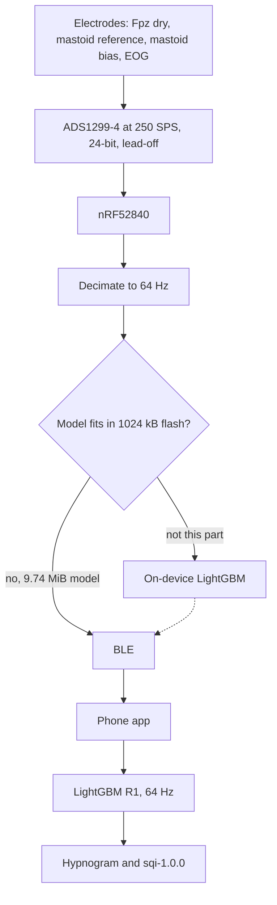

# Hardware concept

Nothing in this note was built or tested in hardware. Part A is a retraining of the frozen LightGBM pipeline on the signals it already has. Part B is a parts list and a power budget for a device that was not assembled.

Tags on claims: **[measured]** from Part A on this machine, **[datasheet]**, **[study]**, **[assumption]** for a design choice that was not measured and is not in a datasheet.

## The montage caveat

Fpz sits on the forehead. Cz sits at the vertex, under hair. A headband cannot record Fpz–Cz. A forehead device records forehead-to-mastoid (for example Fpz–A1 or Fpz–A2) or forehead-to-forehead pairs. Those are different signals, with different amplitude and different spectra, from the derivation Part A actually scored. **[assumption]** about electrode geography of the 10–20 system, which is standard placement and not a result of this experiment.

**The Part A numbers are an upper bound on wearable feasibility. They are not a validated wearable result.**

What published headband studies actually compared:

- Arnal and colleagues recorded the Dreem headband and polysomnography together (*Sleep*, 2020, zsaa097). The headband uses dry electrodes at O1, O2, FpZ, F7, and F8, including FpZ–O1, which still reaches the occiput through hair. It is not Fpz–Cz and it is not a forehead-only pair. Relative spectral power differed from a PSG F3–O1 derivation by a mean percentage error of about 15% (alpha), 16% (beta), 16% (delta), and 10% (theta). Two PSG derivations, F3–O1 and F4–O2, differed by about 7–8% on the same nights. Their own staging algorithm, on their own montage, had accuracy 83.5% ± 6.4% against a five-scorer consensus whose accuracy was 86.4% ± 8.0%. That is agreement of a purpose-built algorithm, not a transfer of a model trained on Fpz–Cz. **[study]**
- A 2024 SLEEP abstract (1076) applied a PSG-trained stager, unmodified, to Dreem 3 and to the simultaneous PSG in 75 people. Cohen’s kappa was 0.82 on the PSG signals and 0.77 on the headband. N1 positive percent agreement fell from 58.4% to 34.7%. **[study]**
- Levendowski and colleagues (*Journal of Clinical Sleep Medicine*, 2017;13:791–803) validated the Sleep Profiler, a forehead recorder with pairs AF7–AF8, AF7–Fpz, and AF8–Fpz. After expert review, kappa against PSG was 0.67, and staging agreed with a majority of scorers on at least 80% of epochs in every stage except N1. When they staged from the shorter pairs they rescaled the spectra, because the short distance and common-mode rejection attenuated the signal. **[study]**

Expected further loss, with no number attached: another drop beyond the Part A deltas, largest on N1, which is already the weak class, and on any feature that needs the 16–30 Hz band or a stable amplitude. Dry contact and a shorter, hair-free derivation both move the spectrum relative to Fpz–Cz. The Dreem transfer result is the qualitative shape of that loss. It is not a correction factor for the macro-F1 below. **[study]** for the direction, **[assumption]** that our model would move the same way.

## Part A — measured

Protocol, unchanged from the frozen pipeline except the input columns: 5-fold `GroupKFold` on the 80 development subjects in `cache/split_workaround.json`, both nights in one fold, seed 42, `num_leaves` 64, `min_data_in_leaf` 100, learning rate 0.05, early stopping patience 50 on validation macro-F1, cap 1000 rounds, balanced sample weights. Macro-F1 is the five-class mean. Fold standard deviation is the sample standard deviation (ddof = 1). The 20 test subjects were not fit and not scored. R0 reproduced the frozen pooled macro-F1 of 0.7726 and the five fold scores in REPORT_1 to the printed precision. `sqi.py`, the release candidate, and `cache/` were not modified. **[measured]**

Age and sex stay in every configuration. They are not channels. EMG stays only where the configuration lists it: R0, because that is the frozen 314-feature model, and R3. R1 and R2 do not contain the EMG envelope. Dropping a channel drops its lags and its rolling band-power means as well. **[measured]**

### A1. Channel configurations

| Config | Inputs | Features | Pooled macro-F1 | Fold SD | SC | ST | Delta vs R0 |
|---|---|---:|---:|---:|---:|---:|---:|
| R0 | Fpz–Cz, Pz–Oz, horizontal EOG, EMG envelope | 314 | 0.7726 | 0.0220 | 0.7661 | 0.7841 | 0 |
| R1 | Fpz–Cz, horizontal EOG | 203 | 0.7537 | 0.0177 | 0.7490 | 0.7569 | −0.0189 |
| R2 | Fpz–Cz only | 107 | 0.7028 | 0.0334 | 0.6935 | 0.7269 | −0.0698 |
| R3 | Fpz–Cz, EMG envelope | 122 | 0.7223 | 0.0357 | 0.7116 | 0.7537 | −0.0503 |

Pooled per-class F1:

| Config | W | N1 | N2 | N3 | REM |
|---|---:|---:|---:|---:|---:|
| R0 | 0.9133 | 0.5155 | 0.8402 | 0.7617 | 0.8322 |
| R1 | 0.8873 | 0.4918 | 0.8251 | 0.7446 | 0.8196 |
| R2 | 0.8521 | 0.4312 | 0.7976 | 0.7265 | 0.7068 |
| R3 | 0.8691 | 0.4499 | 0.8027 | 0.7393 | 0.7506 |

R1 is the best reduced configuration. Losing Pz–Oz and the EMG envelope costs 0.0189 macro-F1. Fpz–Cz alone costs 0.0698, and most of that is REM (0.8322 to 0.7068) and N1 (0.5155 to 0.4312). Putting the chin EMG envelope back, without EOG, recovers part of REM (to 0.7506) and lands at 0.7223, still 0.031 below Fpz plus horizontal EOG. The EMG features are the harmonized envelope already in the frozen matrix: telemetry 100 Hz high-pass 10 Hz, rectify, 1 s RMS; cassette left as the stored 1 Hz envelope. **[measured]**


### A2. Sampling rate on R1

The 100 Hz row is the A1 model. At 64 Hz and 32 Hz the cached epochs were passed through `scipy.signal.resample_poly` (Kaiser window, beta 5.0; up/down 16/25 and 8/25) and the features were recomputed. Welch stays a 4 s Hann with 50% overlap, so the segment length is 256 samples at 64 Hz and 128 at 32 Hz. The same folds, seed, and hyperparameters were used. **[measured]**

| Rate | Nyquist | Pooled macro-F1 | Fold SD | Features | Delta vs 100 Hz |
|---|---:|---:|---:|---:|---:|
| 100 Hz | 50 Hz | 0.7537 | 0.0177 | 203 | 0 |
| 64 Hz | 32 Hz | 0.7543 | 0.0196 | 203 | +0.0006 |
| 32 Hz | 16 Hz | 0.7442 | 0.0179 | 181 | −0.0095 |

At 64 Hz every original band through 30 Hz is still below Nyquist. The relative-power denominator stays 0.4–30 Hz. No band is dropped. The +0.0006 difference is far inside the fold standard deviation. **[measured]**

At 32 Hz the 16–30 Hz band is unavailable, and so is `ratio_delta_beta`, which uses that band. The 12–16 Hz band is capped at 15.75 Hz, one frequency bin below Nyquist (bin width 0.25 Hz). The relative-power denominator is capped at 15.75 Hz. That is the rate that removes the band family behind the strongest full-model features in REPORT_1 (`fpz_ratio_delta_beta`, `fpz_bp_16_30`). The pooled score falls by 0.0095. **[measured]**

The operating point for the rest of this note is **64 Hz**. It keeps the feature set that matched 100 Hz. The analog front end below cannot sample at 64 Hz; it samples at 250 Hz and the microcontroller decimates. **[measured]** for the choice of 64 Hz, **[datasheet]** for the 250 Hz floor, stated in B2.

### A3. SQI on the R1 out-of-fold stages

`sqi-1.0.0` on the 158 development nights. Bias is prediction minus the expert-hypnogram SQI. The full-montage row is the published figure; recomputing it from `sqi_reference.csv` and `sqi_predicted.csv` with the same scorer returned MAE 7.54, bias −0.92, Spearman 0.883. **[measured]**

| Stages | MAE | Bias | Spearman | Nights |
|---|---:|---:|---:|---:|
| Full montage (frozen LightGBM OOF) | 7.54 | −0.92 | 0.883 | 158 |
| R1, Fpz–Cz + EOG | 9.24 | −1.50 | 0.827 | 158 |

Both deliverables move. Staging loses 0.0189 macro-F1. The night index loses 1.70 points of MAE, the bias goes from −0.92 to −1.50, and the rank correlation falls from 0.883 to 0.827. All 158 nights still received a total. **[measured]**

### A4. On-device cost of the R1 model at 64 Hz

One model, refit on the 80 development subjects only, for 286 rounds. That round count is the median of the five early-stopping iterations at 64 Hz. `num_threads` was 1. The test subjects were not in the fit. **[measured]**

| Quantity | Value |
|---|---|
| Model file on disk | 10,210,487 bytes (9.74 MiB), `hardware/models/R1_64hz_refit.txt` |
| Trees | 1,430 (286 rounds × 5 classes) |
| Features per epoch | 203 |
| Night | ST7222J0, a development recording, 958 epochs, 7.98 h |
| Wall time, single thread | 0.303 s inside the timed section (load model, decimate, features, predict). Process real time including interpreter startup was 1.28 s |
| Peak RSS | 442,843,136 bytes (`/usr/bin/time -l`), 422.3 MiB |

The file does not fit in a few hundred KB of flash. A gzip of the same text file is 4,628,879 bytes, still several megabytes, so the conclusion is not an artifact of the text format. The 422 MiB RSS is this CPython process (NumPy, SciPy, pandas, LightGBM), not a microcontroller budget. **[measured]**

## Part B — wearable concept

The device below records a forehead-to-mastoid EEG plus one horizontal EOG channel, decimates to 64 Hz, and sends samples to a phone. It does not record Fpz–Cz. The Part A score for that montage does not exist.

### Sensors and electronics

**Electrodes.** Three contact styles, and only the numbers that have a source.

| Style | Part | What is actually specified | Signal-quality tradeoff |
|---|---|---|---|
| Wet gel | Ambu Neuroline 720, Ag/AgCl, wet gel, self-adhesive | The manufacturer specifies it for sleep recordings and says the adhesive is meant to remain in place if the patient sweats. The product page does not state a skin impedance in kΩ. **[datasheet]** (product specification) | In the same bench comparison as the dry row, a wet frontal contact measured 8.2 ± 1.5 kΩ at 31 Hz. **[study]** Lowest impedance of the three styles in that experiment. Gel can dry and irritate over repeated nights. **[assumption]** |
| Dry | g.SAHARA gold-alloy pins, measured passively; NOK Sotto button type is the forehead geometry | O'Sullivan and colleagues (*Sensors*, 2019;19:2637) measured passive g.SAHARA pins at 226.5 ± 62.4 kΩ frontally at 31 Hz, about 28 times the wet contact in that table. The NOK Sotto datasheet specifies a button electrode for forehead EEG and a bulk product resistance below 0.01 Ω. That resistance is the rubber, not the skin contact. The datasheet does not state skin impedance. **[study]**, **[datasheet]** | No gel and no hair prep on the forehead. The contact impedance in that study is high enough that electrode thermal noise, over the 70 Hz band used in the ADS1299 noise spec, is about 0.51 µV rms at 226.5 kΩ and about 0.10 µV rms at 8.2 kΩ (Johnson noise, 298 K). The converter's shorted-input noise is 1 µV peak-to-peak. A dry forehead contact can dominate the converter. **[study]** for the impedances, **[datasheet]** for 1 µVpp and 70 Hz, **[assumption]** for applying Johnson noise to an overnight recording |
| Semi-dry | No specific part | No datasheet impedance was found for a named semi-dry electrode, so none is stated. A saline or hydrogel reservoir should land between the wet and dry contacts above. That ordering was not measured here. **[assumption]** |

Chosen placement, not the measured montage: dry or semi-dry flat contact at Fpz for the forehead, and Neuroline 720 wet-gel electrodes on the mastoids for reference and bias. Horizontal EOG uses two further small gel electrodes at the outer canthi if the strap reaches, because R1 says that channel is worth 0.031 macro-F1 over Fpz plus chin EMG, and chin EMG is not on a headband. **[measured]** for the 0.031, **[assumption]** for putting EOG on a strap.

**Analog front end.** Texas Instruments ADS1299-4 (datasheet, SBAS499C / the ADS1299-x family Rev. C). **[datasheet]**

| Item | Value |
|---|---|
| Channels | 4 simultaneous, 24-bit. Two are used (EEG, EOG). Per-channel power-down exists; the budget uses the full-device current |
| Data rate | 250 SPS to 16 kSPS. 250 SPS is the minimum, so the part runs at 250 SPS and the MCU decimates to 64 Hz |
| Input-referred noise | 1 µV peak-to-peak, 0.01–70 Hz, gain 24 |
| Input bias current | 300 pA |
| AVDD current | 4.06 mA typical, normal mode, AVDD − AVSS = 5 V, bias amplifiers off |
| DVDD current | 0.54 mA typical at 3.3 V |
| Power | 22 mW typical, 24 mW max, bias amplifiers off |
| Analog supply | 4.75 V to 5.25 V. A single LiPo does not provide this. A boost to 5 V is required |
| Bias amplifier | 20 µA quiescent. Used as the driven ground |
| Lead-off | DC excitation 6 nA at the lowest setting (`ILEAD_OFF` = 00), per channel, comparator in the data stream |

**Microcontroller.** Nordic nRF52840 (Product Specification). **[datasheet]**

| Item | Value |
|---|---|
| Flash / RAM | 1024 kB flash, 256 kB RAM |
| CPU, active | 3.3 mA typical, CoreMark from flash, 64 MHz, DC/DC, HFXO (ICPU0) |
| System ON sleep | 3.16 µA typical, full 256 kB RAM retained, wake on RTC |
| System OFF | 0.40 µA typical, no RAM retention, wake on reset |
| Radio | 4.8 mA TX at 0 dBm, 4.6 mA RX, from the feature summary. CPU plus TX at 0 dBm, DC/DC, is 8.1 mA (IS0). CPU plus RX is 8.6 mA (IS1) |
| Supply | 1.7 V to 5.5 V, so it can sit on the cell |

**Sampling.** Features are computed at 64 Hz, 24-bit samples, two channels, because that is the A2 operating point and the ADS1299 resolution. The converter itself runs at 250 SPS. **[measured]**, **[datasheet]**

**Battery.** LiPol LP502535 pack: nominal 3.7 V, typical capacity 400 mAh, 1.48 Wh, maximum continuous discharge 400 mA. **[datasheet]**

**Boost.** Texas Instruments TPS61023. Quiescent current into VOUT is 20 µA typical. The 94% efficiency point is at 3.6 V in, 5 V out, 1.5 A out. That current is not our load, and it is not used below. **[datasheet]**

### Power budget

Efficiency of the boost at a few milliamps is not tabulated. The budget uses 80% as a design assumption and shows a 50% case so the night does not depend on that guess. Cell voltage is the 3.7 V nominal. Analog current is referred to the cell as `I_AVDD × 5 V / (3.7 V × η)`. The LDO that makes 3.3 V for DVDD is assumed to draw the load current from the cell. Radio duty is derived in the next section (architecture a, with the 3× overhead assumption). **[assumption]** where noted, **[datasheet]** for every current that is not an efficiency.

| Component | Active current | Duty | Average at the cell |
|---|---:|---:|---:|
| ADS1299-4 AVDD, bias off, η = 0.80 | 4.06 mA at 5 V → 6.858 mA | 100% | 6.858 mA |
| Bias amplifier, same η | 20 µA at 5 V → 0.034 mA | 100% | 0.034 mA |
| TPS61023 quiescent, same η | 20 µA from VOUT → 0.034 mA | 100% | 0.034 mA |
| ADS1299-4 DVDD through an LDO | 0.54 mA | 100% | 0.540 mA |
| nRF52840 System ON, full RAM, RTC | 3.16 µA | ~100% | 0.003 mA |
| BLE, architecture (a), 3× airtime assumption | 4.8 mA TX and 4.6 mA RX | 0.92% TX and 0.92% RX | 0.087 mA |
| **Total** | | | **7.56 mA** |

Runtime at 400 mAh: `400 / 7.56 = 53 h`. One 8 h night draws about 60 mAh. **[assumption]** on η, **[datasheet]** on capacity.

At η = 0.50, which is a worse guess and still not a datasheet point, AVDD becomes 11.0 mA at the cell and the total is about 11.7 mA, or 34 h. The 8 h night still fits. The 94% datasheet point would only make the runtime longer, and it is the wrong load, so it is not used. **[assumption]**

SPI servicing of the 250 SPS stream is not in the 3.16 µA sleep figure. That figure is the CPU-off, radio-off, RTC-on specification. **[datasheet]** for the number, **[assumption]** that the missing SPI term is small next to 6.9 mA of converter current.

### On-device inference versus streaming

Two channels, 64 Hz, 24-bit:

```
2 × 64 × 3 bytes = 384 bytes/s = 3072 bit/s
```

Payload airtime on the 1 Mbps PHY, headers ignored: `384 × 8 / 10^6 = 3.07 ms` of TX per second. At 4.8 mA that is 15 µA. An ACK of the same length at 4.6 mA is another 14 µA. Headers, the inter-frame space, and an empty PDU are not in the product specification as a duration, so they are taken as 3× the payload airtime: **87 µA** average. **[datasheet]** for the PHY rate's order and the radio currents, **[assumption]** for equal RX time and the factor of 3.

Architecture (b), on-device, would send a stage once per 30 s epoch instead of 384 bytes/s. A 2 ms connection event (1 ms TX + 1 ms RX, an assumption) every 30 s is about 0.3 µA. The host measurement for the whole night's features and the 1,430-tree model was 0.303 s on one laptop thread. Scaling that by 50× or 100× for a 64 MHz Cortex-M4, which is an assumption and not a benchmark, is 15–30 s at 3.3 mA, or 1–3 µA averaged over 8 h. Compute energy is not the reason to leave the model on the phone. **[measured]** for 0.303 s and 3.3 mA, **[assumption]** for the scaling and the 2 ms event.

The model file is 9.74 MiB. The nRF52840 has 1024 kB of flash and 256 kB of RAM. The model does not fit, compressed or not (gzip of the file is 4.6 MiB). Architecture (b) is not available on this microcontroller without a memory that was not designed here. **[measured]**, **[datasheet]**

**Recommendation: architecture (a).** Stream the decimated 64 Hz samples and run LightGBM and `sqi-1.0.0` on the phone. The radio adds about 0.09 mA, roughly 1% of the 7.6 mA budget. On-device inference would also be cheap in energy, and it would keep raw EEG off the radio, but it does not fit in this part's flash. **[measured]**, **[datasheet]**, **[assumption]** for the 1% after the overhead factor.

### Form factor and a lifted electrode

- EEG: flat dry contact at Fpz, center forehead, held by a soft band. This is the hair-free site. It is not Cz. **[assumption]**
- Reference: Neuroline 720 on one mastoid (A1 or A2), a short lead, not under the band. The derivation is forehead-to-mastoid. **[assumption]**
- Bias (driven ground): the same style of gel electrode on the other mastoid, into the ADS1299 bias pin. The datasheet provides that pin and a 20 µA bias amplifier. **[datasheet]**, **[assumption]** for which mastoid
- EOG: one horizontal pair at the outer canthi, on the same strap or as two small gel electrodes. If the strap cannot reach, this channel is the first thing to drop, and Part A says that drop is the R1-to-R2 gap, 0.051 macro-F1, with the caveat that those numbers are still Fpz–Cz. **[measured]**, **[assumption]**
- Comfort and overnight retention were not tested. The only retention statement in hand is the Neuroline 720 product claim about sweat during a sleep recording. **[datasheet]**, **[assumption]** for the band itself

When an electrode lifts, the ADS1299 lead-off comparator can mark that channel (6 nA DC excitation, status in the sample stream). **[datasheet]** The frozen pipeline has a related flag and a related refusal, and they are not wired together today:

- `is_constant_eeg` is set when the raw Fpz–Cz epoch is flat (minimum equals maximum). Those epochs are removed from LightGBM training only. Inference does not blank them. **[measured]** in the existing cache builder and training mask
- `sqi-1.0.0` keeps unscored epochs in the clock and refuses a total when they exceed 25% of the window (`unknown_fraction`). **[measured]** in `sqi.py`, which was not changed

Design assumption, not implemented: a lead-off bit writes that epoch as unscored, which is the input the index already knows how to refuse. A night that is more than a quarter lead-off then returns `unknown_fraction` and no SQI, instead of a confident hypnogram from a dry contact. **[assumption]**

### Block diagram

The solid path is the recommendation. The on-device model is drawn where it would sit, and it stops because the file does not fit in the nRF52840 flash.



### Limitations

| Claim | Mark |
|---|---|
| R0 pooled macro-F1 0.7726, matching REPORT_1; R1 0.7537, R2 0.7028, R3 0.7223; fold SDs; per-class and SC/ST scores; 64 Hz 0.7543; 32 Hz 0.7442; SQI MAE 9.24, bias −1.50, Spearman 0.827; model 10,210,487 bytes, 1,430 trees, 203 features; 0.303 s and 442,843,136 byte RSS on ST7222J0 | Measured in Part A |
| ADS1299-4 channel count, 24-bit, 250 SPS minimum, 1 µVpp, 300 pA, 4.06 mA, 0.54 mA, 22 mW, 5 V analog supply, 20 µA bias, 6 nA lead-off | Datasheet |
| nRF52840 currents, 1024 kB flash, 256 kB RAM, 4.8 mA TX, 4.6 mA RX, 8.1 mA CPU+TX | Datasheet |
| TPS61023 20 µA quiescent and the 94% point at 1.5 A, which was not used | Datasheet |
| LP502535 3.7 V, 400 mAh | Datasheet |
| Neuroline 720 materials and the sleep-recording claim; NOK Sotto bulk resistance, not skin impedance | Datasheet or product specification |
| Dreem 2020 spectral errors and staging accuracy; Dreem 3 abstract kappa and N1; Sleep Profiler montage, kappa 0.67, and the short-pair rescale; O'Sullivan 2019 impedances 8.2 kΩ and 226.5 kΩ | Published study |
| Part A is an upper bound because Fpz–Cz is not a headband derivation; further loss is real and unquantified here | Published studies for the direction; no number invented |
| Boost efficiency 80% and the 50% stress case; LDO current equals load; BLE header factor of 3; equal RX airtime; 50–100× MCU slowdown; semi-dry impedance ordering; EOG at the canthi; lead-off epochs become SQI-unscored; overnight comfort of the band | Untested design assumption |
| A wearable was built, worn, or electrically tested | Not done |

The test set was not scored. The CNN was not retrained. No board was powered.
